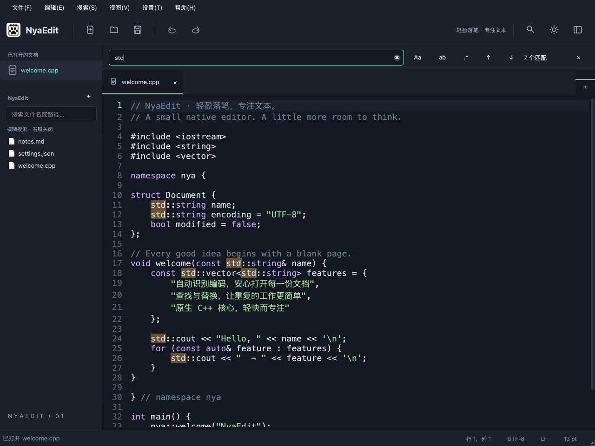

# NyaEdit

一个使用 **C++17 + Qt Widgets + ICU** 编写的原生文本编辑器。支持 Windows、macOS 和 Linux，界面与核心库分离，不引入浏览器运行时。



[查看浅色主题](docs/images/light.png) · [文件夹搜索预览](docs/images/file-search.png) · [欢迎页预览](docs/images/welcome.png) · [字体设置预览](docs/images/font-settings.png)

应用 Logo 根据提供的“活页本＋猫爪”图片重绘，矢量源文件为 [assets/logo.svg](assets/logo.svg)，参考原图保留在 `assets/logo.png`。Logo 通过 Qt 资源内嵌，用于工具栏和应用图标，不依赖运行时工作目录。macOS 的 `assets/logo.icns` 与 Windows 的 `assets/logo.ico` 同样由此 SVG 导出。

## 功能

- 多标签页、可拖动标签、文件夹侧栏、拖放文件。
- 文件树中的文件 / 文件夹、顶部标签和文档列表支持右键在系统文件管理器中打开或定位。
- 文件树右键支持新建文件 / 文件夹、重命名、复制 / 剪切 / 粘贴、复制路径及移到回收站；重命名和移动同步已打开的文档路径。
- 启动欢迎页可新建文档、打开文件或文件夹、选择最近打开的文件与文件夹；最多保存 30 条历史。
- 编辑器偏好与历史记录存入系统对应的用户目录；设置菜单支持一键清空历史，预留独立系统配置文件和接口。
- 文件夹内递归搜索文件名 / 相对路径，默认模糊匹配，右键搜索框可关闭；后台执行，支持键盘打开与 Ctrl/⌘+P 快速聚焦。
- 深色 / 浅色主题、行号、当前行高亮、自定义字体与字号、字体预览和缩放、自动换行。
- 自定义全局背景图片，覆盖欢迎页、侧栏、工具栏、标签栏、编辑区与状态栏；实时预览、可调不透明度与高斯模糊，图片丢失或无法读取时自动取消背景。
- “运行”菜单与项目 `.ne/task.json`：shell / process 命令、工作目录、终端环境继承、配置变量、顺序依赖、默认构建、重跑和停止；底部面板实时显示输出与退出码，也可在系统终端中打开项目目录。详见 [项目任务](docs/tasks.md)。
- 可调速的侧栏收放、文件树展开 / 收起、搜索面板和页面切换动画；可独立开关光标平滑移动 / 闪烁与选区渐变，深浅主题均使用高对比选区。
- BOM / 严格 UTF-8 检查 + ICU 编码推测，并显示检测置信度。
- 手动指定打开编码、按另一编码重新打开、转换保存编码；支持 UTF-8、UTF-16/32、GB18030（兼容 GBK）、Big5、Shift_JIS、EUC-JP/KR、Windows-1251/1252、Latin-1。
- Unicode 编码可选择是否写入 BOM；保留原文件的编码、BOM 和 LF / CRLF / CR 换行方式。
- 查找、替换、全部替换，支持大小写、全词、跨行正则表达式与捕获组替换。
- 撤销 / 重做、自动缩进、多行缩进、行号跳转、基础语法着色。
- Markdown 右侧实时预览，支持标题、强调、列表、引用、代码块、表格和本地图片，无需额外依赖。
- 可选调用系统 Tree-sitter 语法着色，在设置中开关、指定 CLI 和配置；支持未保存内容，调用失败时回退到基础着色。
- 可选连接 LSP 语言服务器，支持自动 / 手动补全、补全项选择、F12 / Ctrl/⌘ 点击定义跳转；在“语言支持”中开关并配置服务器、参数和适用后缀，默认适配 clangd 的 C/C++ 文件。
- 原子保存、未保存提示、不可表示字符检查、磁盘文件变更检测。
- 在后台线程读取和解码文件；只绘制可见行号与可见搜索高亮，文件树按需加载。

## 架构

```text
src/
├── core/                 # NyaEditCore Git 子模块：标准 C++17 + ICU，无 Qt 依赖
│   ├── Encoding.*        # 编码检测、严格解码、严格编码
│   ├── FileIO.*          # 文件加载、换行分析、原子保存
│   ├── FileSearch.*      # 可取消的递归文件名 / 路径搜索
│   └── Search.*          # Unicode 搜索、正则捕获、替换
├── qt/                   # Qt 应用服务与后端类型适配（nya_qt）
│   ├── AppStorage.*      # 配置、系统配置、文件与文件夹历史
│   ├── TreeSitter.*      # QProcess CLI 调度与语法区间解析
│   ├── LspClient.*       # QProcess stdio LSP 协议、文档同步与请求生命周期
│   └── Encoding.* / FileIO.* / Search.* / FileSearch.* # Qt 类型转换
├── ui/                   # 前端：Qt Widgets
│   ├── Editor.*          # 文本视图、行号、输入、可见区高亮
│   ├── EditorCompletion.cpp # 补全弹窗、文本编辑与交互
│   ├── EditorLsp.*       # 语言服务器会话、文档同步、请求与过期结果处理
│   ├── FileTreeView.*    # 文件树节点展开 / 收起的可调速过渡
│   ├── Animation*        # 面板 / 页面过渡、动画偏好与设置对话框
│   ├── FontSettingsDialog.* # 字体、字号选择与实时预览
│   ├── EditorBackground.* / BackgroundSettingsDialog.* # 共享背景、模糊缓存、文件监测与设置预览
│   ├── LanguageSettingsDialog.* # Tree-sitter 开关、可执行文件与配置
│   ├── Highlighter.*     # 基础着色及可选 Tree-sitter 着色
│   ├── MainWindow.*      # 窗口、标签、搜索面板、交互调度
│   ├── WelcomePage.*     # 启动入口、最近文件与文件夹
│   └── Theme.*           # 主题和矢量绘制图标
├── tasks/                # 项目任务解析、变量替换、依赖规划及异步进程执行（Qt Core）
└── main.cpp
```

`nya_core`、`nya_qt`、`nya_tasks` 和 `nya_widgets` 分别构建为独立静态库。core 仅提供标准 C++ 后端接口，UI 经 `nya_qt` 适配层调用；Qt 配置存储与 CLI 调度由应用层负责。文件加载通过 `QtConcurrent` 调度，结果通过 `QFutureWatcher` 送回 UI；任务通过异步 `QProcess` 执行。核心与任务测试可以在没有 GUI 的环境下单独运行。详见 [架构说明](docs/architecture.md)。

核心的源码、构建配置和测试位于 `src/core` 子模块，独立构建与复用方式见 [NyaEditCore](src/core/README.md)。父仓库的 `tests/` 保留 Qt 适配、配置、CLI 调度和界面集成测试。

## 构建

需要 CMake ≥ 3.21、C++17 编译器、Qt ≥ 5.15（推荐 Qt 6）和 ICU ≥ 60。Qt 需要 **Widgets、Concurrent、Svg**，启用测试时还需要 **Test**。无需 Qt WebEngine 或 Qt Core5Compat。

先递归克隆仓库以获取核心子模块：

```sh
git clone --recurse-submodules git@github.com:Thesummert/NyaEdit.git
cd NyaEdit
```

已有克隆在构建前执行 `git submodule update --init --recursive`。更新父仓库后也用该命令同步到记录的核心版本。修改核心后，先在 `src/core` 内提交并推送，再在父仓库提交子模块指针的更新。

### macOS

```sh
brew install cmake ninja qt icu4c
cmake -S . -B build -G Ninja -DCMAKE_BUILD_TYPE=Release \
  -DCMAKE_PREFIX_PATH="$(brew --prefix qt);$(brew --prefix icu4c)"
cmake --build build --parallel
open build/NyaEdit.app
```

### Ubuntu / Debian

```sh
sudo apt install build-essential cmake ninja-build qt6-base-dev libqt6svg6-dev libicu-dev
cmake -S . -B build -G Ninja -DCMAKE_BUILD_TYPE=Release
cmake --build build --parallel
./build/NyaEdit
```

### Arch Linux

```sh
sudo pacman -S --needed base-devel cmake ninja qt6-base qt6-svg icu
cmake -S . -B build -G Ninja -DCMAKE_BUILD_TYPE=Release
cmake --build build --parallel
ctest --test-dir build --output-on-failure
./build/NyaEdit
```

可用 `cmake --install build --prefix dist` 将程序、desktop 文件和图标安装到项目内的 `dist/` 目录；程序入口为 `dist/bin/NyaEdit`，运行时需要系统已安装 Qt 6 和 ICU。

### Windows

使用 Visual Studio 2022 的开发者 PowerShell，安装相同架构的 Qt 和 ICU。可通过 vcpkg 获取依赖：

```powershell
vcpkg install qtbase:x64-windows qtsvg:x64-windows icu:x64-windows
cmake -S . -B build -G Ninja -DCMAKE_BUILD_TYPE=Release `
  -DCMAKE_TOOLCHAIN_FILE=C:/vcpkg/scripts/buildsystems/vcpkg.cmake
cmake --build build --parallel
.\build\NyaEdit.exe
```

将示例中的 vcpkg 路径替换为你的安装路径。若使用 Qt 官方安装包，通过 `-DCMAKE_PREFIX_PATH="Qt安装目录;ICU安装目录"` 指定依赖。编译器、Qt、ICU 和目标架构必须匹配。

### Windows 安装包

使用 x64 Visual Studio 开发者命令提示符，并安装 NSIS 3。先按上面的说明配置 Release 构建目录，然后在 PowerShell 中执行：

`powershell
.\packaging\build-windows.ps1 -BuildDir build/windows-compatible 
  -QtBin C:/Qt/6.8.3/msvc2022_64/bin -IcuBin C:/vcpkg/installed/x64-windows/bin
`

将路径换成实际位置；脚本构建程序并收集 Qt、ICU 和 MSVC 运行库，生成 uild/windows-compatible/NyaEdit-0.1.0-Setup.exe。安装程序默认安装到当前用户目录，提供开始菜单快捷方式和卸载入口。打包脚本需要与项目构建架构匹配的 x64 MSVC、Qt 和 ICU；安装包未经过数字签名。

### 测试

默认启用测试，可用 `-DBUILD_TESTING=OFF` 关闭。

```sh
ctest --test-dir build --output-on-failure
./build/nya_tests                        # 仅核心测试，无需桌面
./build/nya_storage_tests                # 配置与历史持久化测试，无需桌面
./build/nya_tree_sitter_tests            # CLI 调度、取消、超时与高亮位置测试
./build/nya_lsp_tests                    # stdio 协议、文档同步与请求生命周期测试
./build/nya_ui_tests -platform offscreen  # 界面集成测试
./build/nya_lsp_ui_tests -platform offscreen # LSP 开关、补全、跳转与同步集成测试
./build/nya_task_tests                   # 任务配置、实际命令执行与进程停止测试
```

真实 Tree-sitter 集成测试可通过环境变量 `NYA_TEST_TREE_SITTER_EXECUTABLE` 指定 CLI、`NYA_TEST_TREE_SITTER_CONFIG` 指定配置，并以 `NYA_TEST_TREE_SITTER_SUFFIX=c` 或 `json` 选择已安装的解析器。测试覆盖无末尾换行、单个 / 多个末尾换行、行尾空格以及中文、emoji 与不间断空格，兼容旧版表格和新版 `<pre><code>` 高亮输出。

测试覆盖 Unicode/BOM 和中日韩传统编码往返、GB18030 检测、无效字节与不可表示字符拒绝、保存失败时原文件保留、换行保留、Unicode 搜索偏移、正则与零宽匹配、替换上限、撤销、异步打开、重复文件去重、未保存保护和加载期间关闭标签；文件夹搜索覆盖嵌套目录、隐藏文件、中文与路径匹配、结果上限、取消、目录符号链接、切换文件夹、键盘打开和清空搜索。存储和欢迎页测试覆盖配置重启恢复、文件与文件夹历史、去重及数量上限、旧配置迁移、损坏文件保护、写入失败和加载期间清空历史。

本项目已在 macOS ARM64 环境用 Qt 5.15.2 / ICU 73.1，以及 Arch Linux x86_64 环境用 GCC 16.2.1 / Qt 6.12.0 / ICU 78.3 实际构建。Windows 构建尚需在对应环境验证。

### 开发工具

```sh
cmake -S . -B build -DNYA_BUILD_TOOLS=ON
cmake --build build --parallel
./build/nya_preview -platform offscreen build/previews  # 生成欢迎页与深浅主题截图
./build/nya_benchmark -platform offscreen              # 临时文件性能测量
```

预览工具还会导出 Logo PNG、多尺寸 `logo.ico`、`logo.icns` 和 `NyaEdit.iconset`。修改 SVG 后重新运行预览工具，并将生成的 ICO / ICNS 更新到 `assets/` 即可同步系统图标。

macOS 的应用包使用内置 ICNS；底层 Mach-O 文件在 Finder 中的单独图标使用文件元数据。启用 `NYA_BUILD_TOOLS` 后，运行 `cmake --build build --target nya_refresh_file_icons` 可为本地 `.app` 和内部可执行文件设置 / 刷新 Finder 图标。此本地图标元数据可能随复制方式丢失；分发时使用完整 `.app` 应用包。

本机 Release 实测：约 9.3 MB UTF-8 / 15 万行文本，读取、检测、解码及换行归一化约 **131 ms**，15 万处全部替换约 **104 ms**，Qt 文档填充约 **790 ms**。这些为单次本机测量，不包含对话框和磁盘缓存变化，不能作为其他设备的性能保证。

## 使用

不指定文件启动时进入欢迎页，双击最近记录或选中后按回车，即可重新打开对应文件或文件夹。关闭最后一个标签页后返回欢迎页，也可通过“视图 → 欢迎页”随时进入；已打开的文档仍保留在侧栏。

打开文件夹后，该文件夹及子目录内的文件不再单独加入最近文件历史，文件夹本身仍记录；文件夹外单独打开的文件正常记录。判断以发起打开时的文件夹为准，加载期间切换文件夹不会改变此次记录规则。已有历史记录继续保留。

通过文件菜单、拖放或命令行打开文件：

```sh
./build/NyaEdit notes.txt src/main.cpp
# macOS：
./build/NyaEdit.app/Contents/MacOS/NyaEdit notes.txt
```

右下角的**编码**按钮提供两类操作：

- **按另一编码重新打开**：从磁盘重新读取原始字节并解码，用于纠正乱码。存在未保存修改时会询问是否保存。
- **转换保存编码**：保持当前文字，调整保存时使用的编码；点击保存后写入磁盘。无法表示当前字符的编码会被拒绝。

右下角 **LF / CRLF / CR** 可调整保存换行。混合换行文件会在保存前询问是否统一。

打开文件夹后，在左侧搜索框输入文件名或相对路径，即可递归搜索所有子文件夹；不区分大小写，支持中文和隐藏文件。默认开启模糊搜索，输入字符按顺序匹配、允许中间有间隔，例如 `mw` 可找到 `MainWindow.cpp`，`文配` 可找到 `文件配置.txt`。右键搜索框，取消勾选“模糊搜索”可恢复连续片段匹配；搜索框下方显示当前模式与右键操作提示，选择会保存到编辑器配置。

结果按相对路径排序，以区分同名文件。双击结果或按回车打开，搜索框内按 ↓ / ↑ 可进入结果列表，Esc 或清除按钮恢复文件树。Ctrl/⌘+P（或“搜索 → 搜索文件…”）可快速聚焦搜索框，尚未打开文件夹时会先弹出文件夹选择器。

文件搜索在后台执行，输入变化和切换文件夹时取消旧任务，最多显示 1000 个匹配并提示缩小搜索范围。默认跳过 `.git`、`.hg`、`.svn` 目录，不递归跟随目录符号链接。该功能搜索文件名与路径，文档正文查找仍使用 Ctrl/⌘+F。

右键文件树中的文件或文件夹、文件夹标题、顶部标签、已打开文档列表或文件搜索结果，可在系统文件管理器中查看对应项目。macOS 为“在 Finder 中显示”，Windows 为“在文件资源管理器中显示”，会定位并选中该项目；Linux 打开文件所在目录，文件夹则打开自身。菜单操作以右键点击的项目为准；未保存文档及已不存在的路径会禁用此操作。

文件树、文件夹标题和文件搜索结果的右键菜单还提供新建文件、新建文件夹、重命名、复制、剪切、粘贴、复制路径和移到回收站。右键文件时在它所在的目录新建或粘贴，右键文件夹时在该文件夹内操作，右键树的空白处则在项目根目录操作；新建文件会自动打开。项目根目录不允许重命名、剪切或删除。

文件树获得焦点时可使用 **F2** 重命名、**Ctrl/⌘+C / X / V** 复制 / 剪切 / 粘贴、平台删除快捷键移到回收站。每次操作一个文件或文件夹，剪贴板使用本地文件 URL，也能粘贴从系统文件管理器复制的单个项目。同名粘贴生成“副本”名称，创建和重命名不会覆盖已有项目。文件夹复制包括隐藏文件，不允许将文件夹放入自身或子目录；暂不复制符号链接，跨磁盘移动文件夹需使用系统文件管理器。复制与移动在主线程执行，大目录操作可能暂时阻塞界面。

重命名或移动文件夹会同步其中已打开文件的路径，保留未保存内容和撤销记录；加载中的文件需等加载完成再操作。删除前会确认，并询问是否保存相关文档；取消则保留文件，操作成功后关闭相关标签。默认移到回收站，系统回收站不可用时提示失败。**Shift+Delete** 或按住 **Shift** 点击右键菜单中的删除项可永久删除，不经过回收站；确认框会提示无法恢复。永久删除文件夹时会删除其中的所有内容，符号链接只删除链接本身。

“设置 → 字体与字号…”可选择已安装的系统字体，输入 **6–96 pt** 字号，并实时预览中英文及代码。确认后应用到所有已打开文档，后续新建、打开及重启后继续使用该设置。支持恢复默认；取消不会修改编辑器。字体只影响编辑区和行号。

“设置 → 全局背景…”可选择本地图片，并实时预览 **0–100% 不透明度**和 **0–40 高斯模糊强度**。不透明度 0% 为完全透明，100% 为完全不透明；模糊 0 为原图，数值越大越模糊。图片按整个主窗口等比填充、居中裁剪，在欢迎页、侧栏、工具栏、标签栏、编辑区与状态栏间连续显示；滚动文字或切换文档时背景保持固定，调整窗口大小时统一缩放。确认后立即应用并保存，取消不会修改设置；清空图片路径或恢复默认后确认即可取消背景。图片只记录原文件路径；运行中或下次启动时，图片被删除、移动、损坏或不可读会自动恢复各区域的主题底色，并清除保存的背景路径，原文件重新出现也不会自动恢复背景。

“设置 → 动画设置…”可分别开关窗口界面动画、光标动画和选择区域动画，并设置 **0.25–3 ×** 速度，数值越大动画越快。默认全部开启、速度 1 ×；确认后应用于所有文档，新文档与重启后沿用设置。光标移动与选区渐变只影响显示，输入、复制和搜索立即生效；关闭选区动画后仍保留高对比选区颜色。

“设置 → 语言支持…”可开启 **Tree-sitter 语法着色**（默认关闭），使用系统的 `tree-sitter` CLI，也可指定可执行文件完整路径和配置文件。需要先安装 CLI，并按 [Tree-sitter 配置说明](https://tree-sitter.github.io/tree-sitter/cli/init-config.html) 设置 `parser-directories`，确保对应语言解析器包含高亮查询；仅安装 CLI 并不自带所有语言。使用 [官方 highlight 命令](https://tree-sitter.github.io/tree-sitter/cli/highlight.html) 验证 `tree-sitter highlight 文件路径` 能正常着色后即可在编辑器启用。确认后立即应用于所有文档，并保存到下次启动；取消不修改设置。

Tree-sitter 通过后台进程处理临时 UTF-8 快照，未保存的修改也能着色，不改动原文件。编辑后等待 250 ms 刷新，快速修改或关闭开关会取消旧请求；缺少工具、语言解析器或高亮规则，或调用超过 5 秒时使用基础着色。左下角常驻显示当前文档的 Tree-sitter 状态：绿色“正常”、蓝色“解析中”、黄色“异常”，以及“待命”或“已关闭”；悬停可查看具体原因，异常时点击状态可弹出异常信息和排查提示，支持选中文字复制。切换标签时同步切换，临时状态消息不会遮住提示。超过 2 MiB 的内容跳过 Tree-sitter，超长行沿用现有保护。

在“设置 → 语言支持…”勾选“启用 LSP 补全与定义跳转”，填写已安装的语言服务器程序（默认 `clangd`）、启动参数及逗号分隔的文件后缀，确认后保存设置并连接。默认后缀为 `c,cpp,cc,cxx,h,hpp,hxx`；例如 Python 可配置 `pylsp` 和 `py`。服务器以 stdio 启动，每个窗口共用一个会话，以打开的文件夹为项目根目录；未打开文件夹时使用首个匹配文件所在目录。只有匹配后缀的已保存文件参与同步，未保存的新文档需先保存为代码文件；已打开文件的未保存修改会同步给服务器。切换项目文件夹或确认语言设置后重新连接。

输入至少两个标识符字符或服务端指定的触发字符后，等待约 200 ms 自动补全；也可使用 **Alt+/**、**Ctrl/⌘+Space** 或“编辑 → 代码补全”。补全列表用 ↑/↓ 选择，Enter / Tab 或鼠标点击插入，Esc 关闭。支持普通文本、服务端提供的替换范围和额外文本编辑，单次接受可一次撤销；暂不支持片段占位符和补全项命令。**F12**、“编辑 → 转到定义”或 **Ctrl/⌘ 点击** 会打开定义文件并选中目标；多个定义会先显示位置列表。右键菜单也提供补全与跳转。文档内容、光标或标签切换后丢弃旧结果，关闭文档会通知服务器。

左下角 `LSP` 状态显示等待、启动中、就绪或异常；悬停查看详情，点击进入语言支持设置，可确认后重连。关闭开关会停止服务器，不影响编辑。语言服务器需自行安装；clangd 等工具的项目索引 / 编译参数由其自身配置管理。大文件模式和超过约 200 万 UTF-16 单元的内容跳过 LSP，目前不绘制诊断标记。

“视图”菜单的放大 / 缩小、Ctrl+滚轮可调整当前文档字号，保留所选字体，并保存为新文档的默认字号；状态栏字号按钮可恢复到 13 pt。

“视图 → Markdown 预览”或 **Ctrl/⌘+Shift+M** 可打开或关闭右侧预览，也可点击面板的关闭按钮。预览当前标签的内容，支持未保存文档，编辑后约 180 ms 更新；可选择和复制渲染文字，源文件仍按纯文本编辑和保存。支持标题、粗体、斜体、列表、引用、代码块、表格、链接与图片；本地图片相对已保存文件所在目录解析，网页与邮件链接点击后使用系统默认程序打开。预览不渲染原始 HTML，不提供代码块语法着色；超过约 200 万字符时暂停预览。关闭面板后停止渲染。

打开项目文件夹后，通过“运行 → 配置任务…”创建或编辑 `.ne/task.json`，保存后从“项目任务”菜单或“运行任务…”选择执行。支持 shell 脚本、程序及参数、环境变量和顺序依赖；Ctrl/⌘+Shift+B 运行默认构建任务。底部“任务输出”可以查看、复制和清空输出，隐藏面板后命令仍继续运行；“停止任务”同时结束当前步骤及其子进程。支持的字段见 [项目任务说明](docs/tasks.md)，本项目提供了 [CMake 任务配置](.ne/task.json)。

macOS / Linux 的任务会异步读取用户终端导出的环境，补全从桌面启动时缺失的工具路径；`options.env` 可继续覆盖这些设置。“运行 → 在终端中打开”进入当前项目目录，没有项目时使用当前文件目录或用户主目录，方便交互操作。

“设置 → 清除历史记录”立即清空文件、文件夹历史和上次打开目录，并保留主题、字体、自动换行及窗口偏好。“设置 → 打开配置目录”可查看 `editor.ini` 和预留的 `system.ini`；历史记录独立保存为 `history.json`。具体路径、文件格式和扩展接口见 [配置与历史存储](docs/configuration.md)。

| 操作 | Windows / Linux | macOS |
| --- | --- | --- |
| 新建 / 打开 / 保存 | Ctrl+N / O / S | ⌘N / O / S |
| 查找 | Ctrl+F | ⌘F |
| 搜索文件夹中的文件 | Ctrl+P | ⌘P |
| 替换 | 使用搜索菜单中的平台快捷键 | 使用搜索菜单中的平台快捷键 |
| 跳转到行 | Ctrl+L | ⌘L |
| 侧边栏 | Ctrl+B | ⌘B |
| 关闭标签 | Ctrl+W | ⌘W |
| 撤销 / 重做 | 平台标准快捷键 | 平台标准快捷键 |
| 缩进 / 取消缩进 | Tab / Shift+Tab | Tab / Shift+Tab |
| 关闭搜索面板 | Esc | Esc |

正则使用 PCRE2 语法，默认开启多行锚点；跨行内容可用 `\n` 或 `(?s)`。替换支持 `$1`、`${name}` 和 `$$`（字面量 `$`）。普通文本替换不会展开捕获组。全部替换可以一次撤销。

## 性能范围与限制

- 适用于常规文本、配置、代码和中等大小日志；使用 Qt 文档模型在内存中编辑，当前不是面向 GB 级文件的分块编辑器。
- 单文件打开上限 **128 MiB**；大于 **16 MiB** 提示确认；大于 **2 MiB** 关闭语法着色；单行超过 12000 字符不着色。载入文档布局、保存及搜索目前仍在主线程执行，较大文件可能短暂阻塞界面。
- 搜索导航保留前 **20000** 个匹配；全部替换处理整个文档。复杂正则的执行时间取决于表达式和输入内容。
- 无 BOM 的传统编码只能推测，短文本或混合语言可能误判。检测置信度只表示启发式判断，不保证正确，可手动指定编码。
- 混合换行保存时会统一；U+2028/U+2029 分隔符文件目前拒绝打开，以避免 Qt 文档模型隐式转换造成损失。不支持二进制文件编辑。
- 内置语法着色为基础规则，可选 Tree-sitter 着色和 LSP 补全 / 定义跳转；暂不提供诊断绘制、片段占位符或多语言服务器同时运行。后端接口见 [NyaEditCore](src/core/README.md)。
- 暂无崩溃恢复 / 自动备份；正常关闭时会询问是否保存。

## 发布

`cmake --install build --prefix dist` 可安装应用。Linux 会同时安装 desktop 文件和 SVG 图标。分发给未安装 Qt 的机器前，需要部署动态依赖：macOS 使用 `macdeployqt`，Windows 使用 `windeployqt` 并包含 ICU DLL，Linux 使用发行包或 AppImage 等方式。正式分发还需按平台签名 / 公证，并遵守 Qt 与 ICU 的许可证。当前源码构建产物不等于已签名、可独立分发的安装包。

参考：[Qt 原子保存](https://doc.qt.io/qt-6/qsavefile.html)、[ICU 编码检测及其局限](https://unicode-org.github.io/icu/userguide/conversion/detection)、[ICU 严格转换](https://unicode-org.github.io/icu/userguide/conversion/converters.html)。
