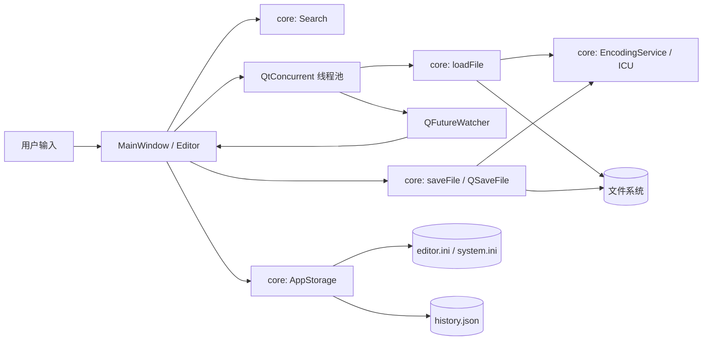

# 前后端边界

NyaEdit 采用进程内的原生分层架构。前端为 Qt Widgets，后端为独立 C++ 库，无 HTTP 服务、浏览器或 JavaScript 桥接。

## 核心库 `nya_core`

- `EncodingService`：BOM 确定编码、UTF-8 严格验证、ICU 统计检测、严格编码与解码。每次调用创建自己的转换器，不跨线程共享 ICU 状态。自动检测采样前 256 KiB，再针对候选编码严格解码整个文件。
- `loadFile`：以二进制模式读取，返回 `LoadedFile`；其中包含文本、编码、BOM、换行方式、磁盘时间和错误信息。内部统一为 LF，保存时再恢复目标换行。无效字节不会静默替换为问号。
- `saveFile`：先完成严格编码，再通过 `QSaveFile` 写临时文件并提交；不启用直接覆盖回退。编码失败不会触碰目标文件。
- `Search`：使用 Unicode 正则引擎，同时支持字面量模式；返回 UTF-16 位置，与 Qt 文本光标一致。零宽匹配由全局匹配迭代器推进；全部替换在原始快照上构建结果，避免替换内容再次参与匹配。
- `FileSearch`：递归查找文件名与相对路径，默认按 Unicode 码点进行不区分大小写的有序非连续模糊匹配，也可通过 `FileSearchMode::Substring` 指定连续片段匹配。包含隐藏文件，跳过版本控制元数据目录和目录符号链接。使用共享原子标志取消任务，结果最多保留 1000 条并按相对路径排序；不访问 QWidget 或文件正文。
- `AppStorage`：以 `QStandardPaths` 选择用户配置与数据目录，以 `QSettings` 保存编辑器偏好和预留系统配置，以 `QSaveFile` 原子保存文件 / 文件夹历史。支持注入路径供测试和其他前端使用，通过信号报告变更与错误；当前由 GUI 线程调用。详见 [存储接口](configuration.md)。
- `TreeSitter`：通过异步 `QProcess` 调用系统 CLI 的 `highlight --html --css-classes`，读取用户配置中的语言解析器和查询。以 UTF-8 临时快照处理未保存内容，按后缀选择语言；HTML 捕获转换为 UTF-16 区间，验证解码后的文本与快照一致后再交给 UI。请求版本号防止旧结果覆盖新内容；取消及销毁时终止进程。运行限时 5 秒，输入上限 2 MiB，输出上限 32 MiB，不依赖 Tree-sitter 开发库。

核心接口使用值类型、普通函数及 QObject 信号，不产生界面副作用。核心依赖 Qt Core 与 ICU，能够供 CLI、测试或其他原生前端复用。

核心由独立仓库 `NyaEditCore` 维护，以 Git 子模块放在 `src/core`。其 CMake 配置负责构建 `nya_core` 和三组核心测试，既支持单独构建，也支持由父项目通过 `add_subdirectory(src/core)` 集成。父仓库只维护界面和界面集成测试；完整构建时仍会运行核心测试。

## 界面库 `nya_widgets`

- `MainWindow` 管理用户交互：文件对话框、编码选择、标签与当前文档、保存确认、快捷键、最近记录和设置。通过 `AppStorage` 访问持久化数据，不直接操作配置文件。
- `WelcomePage` 展示新建 / 打开入口和文件 / 文件夹历史，仅通过信号请求窗口执行操作。启动时或关闭最后一个标签页后显示欢迎页；历史不会自动恢复未保存的正文。
- `Editor` 管理 Qt 文档、光标、撤销栈、行号和可见搜索标记。文档的 UI 状态与对应磁盘元信息在该视图实例上关联。
- `FileTreeView` 管理文件树展开 / 收起的可调速滑动，只缓存可见区域。节点状态立即改变，首次展开等待异步子节点到达后开始过渡；首帧和布局准备好后才开始计时，自动滚动条变化不会中断过渡。快速反向操作延续当前位置，正常结束保留文档布局对应的缓存供后续切换复用；隐藏、主动滚动、切换根目录或主题时丢弃旧画面。动画沿用窗口界面开关与速度。
- `FontSettingsDialog` 提供系统字体选择、字号输入和实时预览，确认后由 `MainWindow` 保存字体名称 / 字号并应用到所有文档。字体设置不改变正文、光标选择或未保存状态；`Editor` 更新行号宽度与制表符宽度，并在切换主题后保留字体。
- `Highlighter` 按后缀提供基础着色，对大文件和超长行禁用着色。可选的 Tree-sitter 着色在编辑后防抖 250 ms 调用，支持函数、类型、关键字、字符串、注释、数字等捕获，使用应用的深浅主题；工具不可用或调用失败时回退到基础着色。`LanguageSettingsDialog` 提供开关、可执行文件和配置路径，确认后由 `MainWindow` 持久化并应用到所有文档。
- `Theme` 管理调色板、样式和图标，通过菜单初始化事件统一设置透明圆角菜单窗口，覆盖文件右键菜单和 Qt 自带的编辑菜单。应用 Logo 使用资源内嵌的 `assets/logo.svg`，由 Qt SVG 渲染为多个图标尺寸；操作图标通过 `QPainter` 绘制，不依赖网络字体、图片服务或运行时工作目录。
- `TaskPanel` 管理底部任务输出，合并批量刷新、过滤终端控制序列并限制输出长度；关闭面板不停止任务。`MainWindow` 提供运行菜单、任务选择、示例配置创建和项目上下文，不在打开项目时自动执行命令。

项目任务的应用层库 `nya_tasks` 位于父仓库 `src/tasks`，只依赖 Qt Core，独立于核心子模块。`TaskConfiguration` 解析 `.ne/task.json`，验证任务字段、变量和顺序依赖，生成按运行开始时上下文冻结的命令计划。`TaskRunner` 通过异步 `QProcess` 顺序执行，增量解码 UTF-8 并报告输出和退出状态；任何一步失败即停止后续步骤。Unix 使用独立会话 / 进程组管理子进程，Windows 使用 Job Object；停止和销毁时清理整组进程，Unix 在温和停止超时后强制结束。任务配置不属于用户级 `editor.ini`，可以随项目提交，详见 [任务机制](tasks.md)。

Unix 上 `TaskRunner` 在规划命令前异步读取用户登录交互 shell 导出的环境，通过随机边界标记和 NUL 分隔解析，隔离启动提示并支持含换行的环境值；8 秒超时回退到应用环境。环境探测与任务共用进程组清理和停止机制，显式 `options.env` 仍最后覆盖。`MainWindow` 的“在终端中打开”使用独立系统终端进入项目 / 文件目录，目录通过参数及工作目录传递。

读取和解码在 `QtConcurrent` 中执行，只向工作线程传路径 / 编码字符串。`QFutureWatcher` 回调在 GUI 线程应用结果，通过 `QPointer` 和标签归属检查避免已关闭视图收到异步结果。Qt 文档和所有 QWidget 只在 GUI 线程访问。

文件夹搜索有独立的 180 ms 输入防抖计时器。输入变化、切换根目录或切换匹配模式时，立即取消前一个搜索并增加请求版本号；后台 `FileSearch` 只接收根路径、查询、匹配模式、结果上限和取消标志。回调只应用当前版本的结果，防止旧目录、旧关键词或旧模式的结果覆盖当前列表。窗口销毁时同样发出取消标志。右键菜单保留搜索框的标准编辑操作，并添加模糊搜索开关；选择保存到 `search/fuzzy`。

文件成功加载后才写入历史，打开文件夹成功后记录其类型与路径。清空历史会增加窗口的历史版本号，已在读取中的旧任务完成时不再回填记录。普通保存不重新登记已有文件，重新打开或另存为新路径会记录新的打开行为。

`MainWindow` 根据本次打开时的文件夹路径过滤文件历史：根目录及子目录内的文件不单独记录，文件夹外的文件正常记录。文件加载任务捕获该路径，避免用户在加载期间切换文件夹改变记录规则；核心 `AppStorage` 仍提供通用的历史存储接口。

## 数据保护

1. BOM 和确定有效的 UTF-8 优先于统计检测。
2. 自动检测显示置信度，支持手动重新解码。传统编码不能保证百分之百识别。
3. 切换保存编码时提前检查字符是否可表示，保存时再次检查。
4. 保存前比较磁盘修改时间和文件长度；发现外部修改或删除时要求确认覆盖。这不是文件锁，也不能防止确认后的并发写入。
5. 普通关闭、退出、重新解码前检查正文和编码 / 换行元数据是否未保存。
6. 保留不间断空格，拒绝无法无损映射到 Qt 段落模型的 Unicode 分隔符，混合换行归一化前询问用户。

## 后续扩展

要支持 GB 级文件，应增加独立文档存储层（分块缓冲 / piece table 或 rope），让视图按可见范围取文本，而不是继续扩大 `QTextDocument` 的文件限制。异步搜索也可在核心快照上执行，并使用文档版本号丢弃过期结果。
